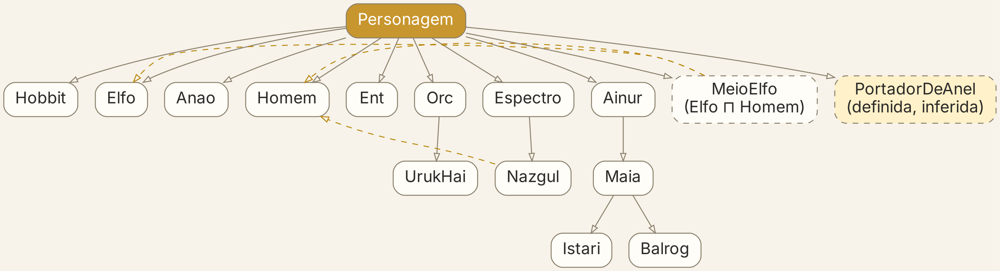
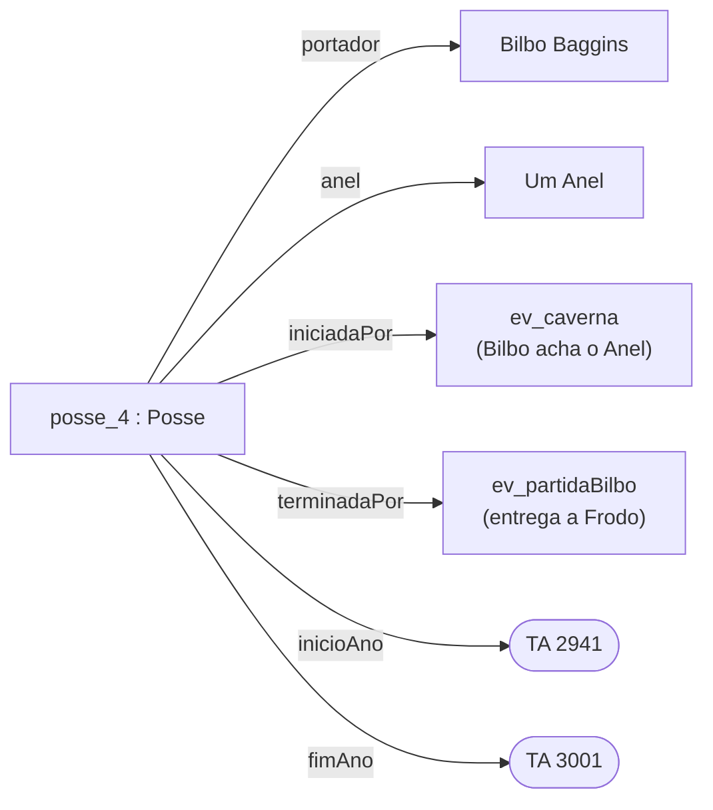
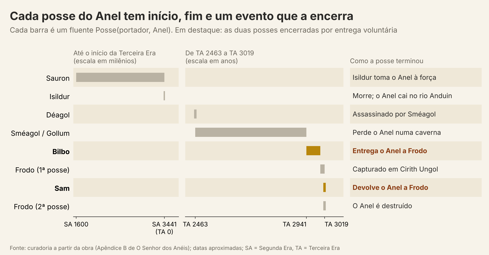
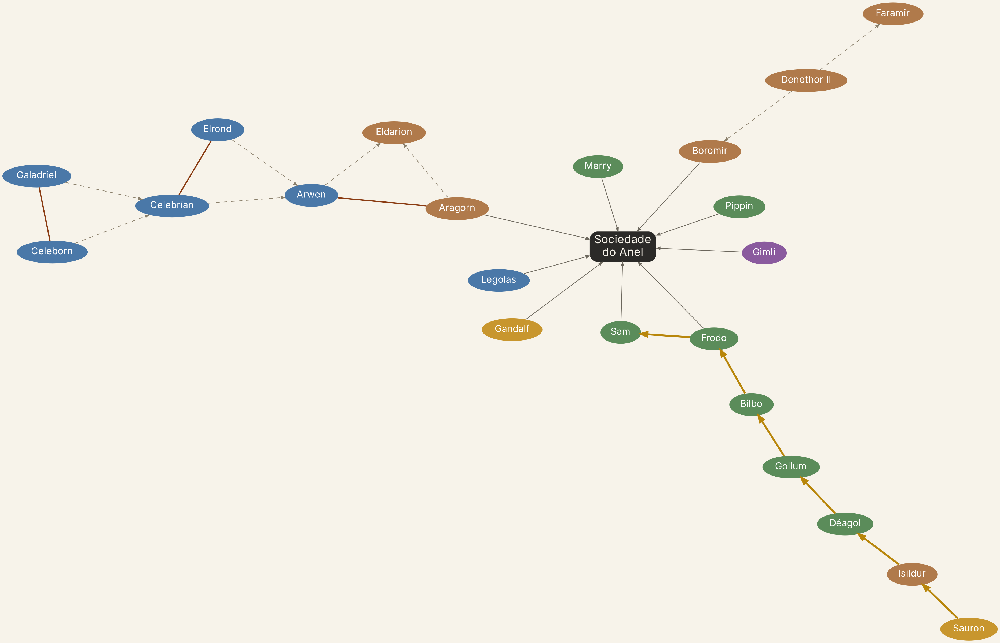

# Quem é Aragorn? Ontologias e grafos de conhecimento na Terra-média

Seminário da disciplina **Processamento de Linguagem Natural (PLN)** — Programa de Pós-Graduação em Computação (PPGCC), Universidade Federal do Pará (UFPA).

Construímos uma ontologia em OWL e um grafo de conhecimento sobre *O Senhor dos Anéis* para mostrar, num domínio que todo mundo conhece, o que uma ontologia é, o que um raciocinador faz com ela e por que isso importa para o PLN.

| | |
|---|---|
| **Disciplina** | Processamento de Linguagem Natural |
| **Docente** | Profa. Dra. Paula Christina Figueira Cardoso (FACOMP / PPGCC) |
| **Instituição** | Universidade Federal do Pará (UFPA) |
| **Apresentação** | 09/11/2026 |

### Equipe

| Integrante | Matrícula |
|---|---|
| João Davi Costa Lima | 202620070018 |
| Lizandra de Lima Quaresma | 202620070036 |
| Lucas Nobre Barbosa | 202620070026 |

---

## Sumário

1. [O problema](#1-o-problema)
2. [Por que ontologias?](#2-por-que-ontologias)
3. [A ontologia construída](#3-a-ontologia-construída)
4. [Consultas e raciocínio](#4-consultas-e-raciocínio)
5. [Como usar](#5-como-usar)
6. [Estrutura do repositório](#6-estrutura-do-repositório)
7. [Fontes de dados](#7-fontes-de-dados)
8. [Limitações](#8-limitações)
9. [Referências](#9-referências)

---

## 1. O problema

Se pedirmos a um computador que conte quantas vezes Aragorn aparece nos três volumes de *O Senhor dos Anéis*, a busca pelo nome devolve **721** menções. Mas o leitor sabe que *Passolargo* (Strider, **231** menções) e *Elessar* (**16**) são a mesma pessoa. Somando, são 968: a busca por palavra-chave perde **25,5%** das menções.

Para a máquina, “Strider” e “Aragorn” são cadeias de caracteres diferentes. Dizer de forma explícita que são o mesmo indivíduo é o primeiro trabalho de uma ontologia, e é a pergunta que dá nome ao seminário.

## 2. Por que ontologias?

### O que é uma ontologia

A definição mais usada vem de Studer, Benjamins e Fensel (1998), que unem as formulações de Gruber (1993) e Borst (1997):

> Uma ontologia é uma **especificação formal, explícita e compartilhada de uma conceitualização**.

- **Explícita:** os conceitos e as restrições são declarados, não ficam implícitos no código ou na cabeça de quem modelou.
- **Formal:** é legível por máquina, ao contrário da linguagem natural.
- **Compartilhada:** registra um conhecimento aceito por um grupo. Gruber chama cada ontologia de um *tratado*, um acordo social entre quem tem motivo para compartilhar.

### Taxonomia, ontologia e grafo de conhecimento

| Nível | O que representa | Exemplo no projeto |
|---|---|---|
| **Taxonomia** | Só a hierarquia “é um tipo de” | `Hobbit ⊂ Personagem ⊂ Ser` |
| **Ontologia** | Classes, relações e **axiomas** (regras lógicas) | `PortadorDeAnel ≡ Personagem ⊓ ∃jaPortou.AnelDePoder` |
| **Grafo de conhecimento** | Fatos sobre indivíduos concretos, ligados em grafo | `Frodo → portador → Posse nº 6 → anel → Um Anel` |

Classes, propriedades e axiomas formam o **esquema** (TBox); os fatos sobre indivíduos formam o **acervo** (ABox). Juntos, compõem a base de conhecimento (Noy; McGuinness, 2001).

### O que se ganha com uma ontologia

- **Vocabulário comum.** Sistemas e pessoas diferentes passam a usar os mesmos conceitos com o mesmo significado.
- **Dedução.** Um *raciocinador* deriva fatos que ninguém escreveu. Se todo Hobbit é Personagem e Frodo é Hobbit, Frodo é Personagem. Não é aprendizado de máquina: é lógica, e o resultado é verificável.
- **Classificação.** Indivíduos são encaixados nas classes certas a partir das definições. Nenhum personagem foi declarado `PortadorDeAnel`; o raciocinador os encontra.
- **Consistência.** Contradições são detectadas automaticamente. Se Hobbit e Anão são disjuntos, afirmar que Frodo é Anão gera um erro.
- **Identidade.** Um nome não é um indivíduo. Vários nomes podem apontar para a mesma entidade (Aragorn, Passolargo, Elessar, Estel), e um nome pode apontar para várias (há três Boromir no dataset).
- **Mundo aberto.** Em OWL, a ausência de um fato significa *desconhecido*, não *falso*. Personagens sem povo registrado têm uma lacuna nos dados, e não “nenhum povo”.

### Os padrões da Web Semântica

| Padrão | Papel |
|---|---|
| **RDF** | Modelo de dados em triplas (sujeito, predicado, objeto). `Frodo · tipo · Hobbit` já é uma tripla. |
| **RDFS** | Classes, subclasses, domínio e imagem de propriedades. |
| **OWL** | Axiomas com semântica lógica (lógica de descrição): disjunção, simetria, transitividade, classes definidas. |
| **SPARQL** | Linguagem de consulta sobre triplas. |
| **Turtle** | Sintaxe textual de RDF usada no arquivo da ontologia. |

### Onde o PLN entra

Em PLN, a ontologia é o **destino** dos pipelines de extração e a **fonte** de fatos verificáveis:

| Tarefa de PLN | O que fizemos no caso | Papel da ontologia |
|---|---|---|
| Reconhecimento de entidades | Achar “Frodo” e “Passolargo” no texto | Define os tipos: Personagem, Lugar, Artefato |
| Ligação de entidades | Passolargo → Aragorn II Elessar | Um identificador único por indivíduo |
| Correferência | Sméagol = Gollum | `owl:sameAs` |
| Extração de informação | 631 menções viram fatos no grafo | O esquema que recebe os fatos |
| Perguntas e respostas | “Quem teve o Anel antes de Bilbo?” em SPARQL | Fatos verificáveis; base para GraphRAG |

Fora da Terra-média, a mesma ideia sustenta o Wikidata, o Google Knowledge Graph, o SNOMED CT (terminologia clínica), a Gene Ontology e o schema.org. Com os LLMs, grafos de conhecimento voltaram ao centro: o GraphRAG (Edge et al., 2024) usa grafos como índice para responder perguntas sobre coleções inteiras de texto, e Pan et al. (2024) discutem como LLMs e grafos compensam as fraquezas um do outro.

## 3. A ontologia construída

Arquivo: [`ontologia/ontologia_lotr_completa.ttl`](ontologia/ontologia_lotr_completa.ttl) (OWL em Turtle, abre no [Protégé](https://protege.stanford.edu/)).

| Elemento | Quantidade |
|---|---|
| Classes | 46 |
| Propriedades de objeto | 19 |
| Propriedades de dados | 19 |
| Triplas declaradas | ~12,9 mil |
| Triplas após o raciocínio OWL-RL | ~26,8 mil |
| Personagens | 911 |
| Capítulos dos livros | 62 |
| Menções extraídas do texto | 631 |
| Obras de cinema | 8 (6 filmes e 2 séries) |
| Participações faladas nos filmes | 76 |
| Indivíduos curados à mão | 33 |

A construção seguiu o método de Noy e McGuinness (2001): definir domínio e escopo (com perguntas de competência como “quem teve o Anel antes de Bilbo?”), enumerar termos, definir classes, propriedades e restrições e, por fim, criar as instâncias.

### Hierarquia de personagens



*Linhas tracejadas: herança múltipla.*

### Principais decisões de modelagem

- **Povos como subclasses** de `Personagem` (herança direta). O custo aparece nos híbridos: Elrond e Arwen são Meio-elfos (Elfo e Homem), Lúthien é Elfa e Maia, os Nazgûl são Homens e Espectros.
- **Disjunção parcial.** Hobbit, Anão, Ent, Orc, Ainur, Elfo e Homem são disjuntos entre si, com exceção dos cruzamentos acima.
- **Classe definida.** `PortadorDeAnel` não é atribuída a ninguém: equivale a qualquer `Personagem` que `jaPortou` algum `AnelDePoder`. A propriedade `jaPortou` é uma cadeia de propriedades (`ePortadorEm` seguida de `anel`).
- **Propriedades com semântica.** `conjugeDe` é simétrica; `ancestralDe` é transitiva e deduzida a partir de `paiOuMaeDe`.
- **Fluentes reificados** (cálculo de eventos, Russell e Norvig, cap. 12): “Frodo é portador do Anel” não é verdade eterna, vale num intervalo. Cada `Posse` e cada `Participacao` na Sociedade tem início e fim marcados por eventos.
- **Identidade.** Apelidos como `skos:altLabel`; `owl:sameAs` entre “Sméagol (falante)” e Gollum; um identificador por indivíduo, mesmo com nomes iguais.
- **Proveniência.** Cada indivíduo indica de onde veio: `dataset:…`, `extraido:…` ou `curadoria`.

Exemplo de uma posse do Um Anel como fluente:





## 4. Consultas e raciocínio

As consultas foram executadas em SPARQL sobre o grafo expandido pelo raciocinador OWL-RL. A saída completa está em [`consultas/resultados_consultas.md`](consultas/resultados_consultas.md).

| # | Pergunta | O que demonstra | Resultado |
|---|---|---|---|
| Q1 | Quem já portou o Um Anel? | Classe definida | Sauron, Isildur, Déagol, Gollum, Bilbo, Frodo e Sam, sem que nenhum tenha sido declarado `PortadorDeAnel` |
| Q2 | Qual a sequência de posses do Anel? | Fluentes e eventos | Sauron → Isildur → Déagol → Gollum → Bilbo → Frodo → Sam → Frodo |
| Q3 | Quem são os ancestrais de Arwen? | Propriedade transitiva | Celeborn, Celebrían, Elrond, Galadriel |
| Q4 | Membros da Sociedade por povo | Herança de classes | Hobbit 4, Homem 2, Elfo 1, Anão 1, Maia 1 |
| Q5 | Casais sem povo em comum | Auditoria de qualidade | 3 casais (ex.: Idril e Tuor) |
| Q6 | Quem mais fala nos filmes? | Identidade (`owl:sameAs`) | Unindo Sméagol e Gollum, Gollum sobe para o 5º lugar |
| Q7 | Personagens sem povo declarado | Mundo aberto | 153 (desconhecido ≠ inexistente) |
| Q8 | Quem deixou a Sociedade e por qual evento? | Fluente com fim | Os nove, pela Quebra da Sociedade (26/02/TA 3019) |
| Q9 | E se Frodo fosse Anão? | Verificação de consistência | O raciocinador acusa a violação da disjunção Hobbit/Anão |

Com o raciocínio, o grafo praticamente dobra de tamanho: são mais de 13 mil triplas que ninguém digitou.

### O grafo



*Sociedade do Anel, cadeia de portadores do Anel (dourado) e linhagem de Galadriel a Eldarion. Tracejado: pai/mãe de; marrom cheio: casamento; cor do nó: povo.*

“Quem é a avó da esposa de Aragorn?” Aragorn é casado com Arwen, filha de Celebrían, filha de Galadriel. Nenhuma frase do livro diz isso dessa forma; a resposta sai do grafo.

## 5. Como usar

### No Protégé

Abra `ontologia/ontologia_lotr_completa.ttl` no [Protégé](https://protege.stanford.edu/), ative um raciocinador (HermiT ou Pellet) e explore classes, indivíduos e inferências.

### Em Python

Requer Python 3.

```bash
pip install -r requirements.txt
```

O exemplo abaixo carrega a ontologia, aplica o raciocinador OWL-RL e mostra o efeito da classe definida e da propriedade transitiva:

```python
import rdflib, owlrl

g = rdflib.Graph()
g.parse("ontologia/ontologia_lotr_completa.ttl", format="turtle")

PREFIXOS = """
PREFIX lotr: <http://example.org/lotr#>
PREFIX rdfs: <http://www.w3.org/2000/01/rdf-schema#>
"""
portadores = PREFIXOS + "SELECT DISTINCT ?x WHERE { ?x a lotr:PortadorDeAnel }"

print("Antes do raciocínio:", len(g), "triplas;",
      len(g.query(portadores)), "portadores de anel")

owlrl.DeductiveClosure(owlrl.OWLRL_Semantics).expand(g)  # leva alguns segundos

print("Depois do raciocínio:", len(g), "triplas;",
      len(g.query(portadores)), "portadores de anel")

ancestrais = PREFIXOS + """
SELECT ?nome WHERE { ?x lotr:ancestralDe lotr:Arwen ; rdfs:label ?nome }
ORDER BY ?nome
"""
for linha in g.query(ancestrais):
    print(linha.nome)
```

Saída esperada:

```
Antes do raciocínio: 12935 triplas; 0 portadores de anel
Depois do raciocínio: 26810 triplas; 8 portadores de anel
Celeborn
Celebrían
Elrond
Galadriel
```

Os 8 portadores incluem “Sméagol (falante)”, ligado a Gollum por `owl:sameAs`.

### Pipeline completo

O pipeline que gera a ontologia, as consultas e as figuras roda nesta ordem:

| Script | Função |
|---|---|
| `mentions.py` | Contagem de menções no texto dos livros |
| `build_kg.py` | Gera `ontologia_lotr_completa.ttl` a partir dos dados |
| `consultas_sparql.py` | Executa as consultas SPARQL e o raciocinador OWL-RL |
| `figs.py`, `fig5.py`, `graphs.py` | Geram as figuras |

Os scripts serão disponibilizados na pasta `scripts/`. A geração das figuras requer também o [Graphviz](https://graphviz.org/) instalado no sistema.

## 6. Estrutura do repositório

```
.
├── README.md
├── requirements.txt
├── ontologia/
│   └── ontologia_lotr_completa.ttl     # esquema OWL + grafo de conhecimento (Turtle)
├── consultas/
│   └── resultados_consultas.md         # saída das consultas Q1–Q9
├── figuras/
│   ├── fig1_hierarquia_personagem.png
│   ├── fig2_subgrafo_sociedade.png
│   └── fig3_posses_um_anel.png
└── docs/
    ├── slides_ontologias_terra_media.pdf   # apresentação (21 slides)
    └── roteiro_seminario_ontologias.docx   # roteiro de fala e guia de estudo
```

## 7. Fontes de dados

| Arquivo | Volume | Uso |
|---|---|---|
| `lotr_characters.csv` | 911 linhas | Personagens: povo, gênero, nascimento, morte, reino, cônjuge |
| `Characters.csv` | 757 linhas | URL da wiki de cada personagem |
| `WordsByCharacter.csv` | 731 linhas | Palavras faladas por personagem e filme |
| `Movies.csv` | 8 linhas | Duração, orçamento, bilheteria, Oscar, Rotten Tomatoes |
| `LordOfTheRingsBook.json` | 62 capítulos | Texto dos três volumes, base das menções |

Os arquivos vêm de datasets públicos do Kaggle; as transcrições dos filmes vêm do Fandom (movies.fandom.com) e os dados de personagens, da wiki de *O Senhor dos Anéis*. Os dados brutos não estão neste repositório. A curadoria manual (posses do Anel, eventos e Sociedade) foi feita a partir do Apêndice B de *O Senhor dos Anéis*.

*O Senhor dos Anéis* e seus personagens pertencem ao espólio de J. R. R. Tolkien e aos respectivos detentores de direitos. Este trabalho tem fins exclusivamente didáticos.

## 8. Limitações

- **Curadoria não escala.** A camada manual tem só 33 indivíduos; foi o mesmo limite que o projeto Cyc encontrou.
- **Menções por casamento de padrões.** A contagem usa nomes e apelidos conhecidos, com fronteira de palavra. “Sam” pode ser ambíguo e apelidos fora da lista não são contados. Não houve avaliação de precisão e cobertura com amostra anotada.
- **Datas aproximadas.** As datas das posses foram curadas do Apêndice B e são relativas ao início da Terceira Era.
- **Perfil OWL-RL.** É executado por regras e cobre menos axiomas que raciocinadores completos de lógica de descrição, como HermiT e Pellet.
- **Sem reuso de ontologias.** Não reutilizamos vocabulários existentes para tempo ou proveniência, o que seria o primeiro passo num projeto real.
- **Namespace de exemplo.** Os identificadores usam `http://example.org/lotr#`.
- **Sem validação externa.** A ontologia responde às perguntas de competência e é logicamente consistente, mas não foi avaliada por especialistas em Tolkien.

## 9. Referências

BERNERS-LEE, T.; HENDLER, J.; LASSILA, O. The Semantic Web. **Scientific American**, v. 284, n. 5, p. 34-43, maio 2001.

EDGE, D. et al. From local to global: a Graph RAG approach to query-focused summarization. **arXiv**:2404.16130, 2024.

GRUBER, T. R. A translation approach to portable ontology specifications. **Knowledge Acquisition**, v. 5, n. 2, p. 199-220, 1993.

GRUBER, T. R. Toward principles for the design of ontologies used for knowledge sharing. **International Journal of Human-Computer Studies**, v. 43, n. 5-6, p. 907-928, 1995.

GUARINO, N.; OBERLE, D.; STAAB, S. What is an ontology? In: STAAB, S.; STUDER, R. (ed.). **Handbook on Ontologies**. Berlin: Springer, 2009. p. 1-17.

HOGAN, A. et al. Knowledge graphs. **ACM Computing Surveys**, v. 54, n. 4, art. 71, p. 1-37, 2021. DOI: 10.1145/3447772.

JI, S. et al. A survey on knowledge graphs: representation, acquisition, and applications. **IEEE Transactions on Neural Networks and Learning Systems**, v. 33, n. 2, p. 494-514, 2022.

NOY, N. F.; MCGUINNESS, D. L. **Ontology development 101**: a guide to creating your first ontology. Stanford Knowledge Systems Laboratory, Technical Report KSL-01-05, 2001.

PAN, S. et al. Unifying large language models and knowledge graphs: a roadmap. **IEEE Transactions on Knowledge and Data Engineering**, v. 36, n. 7, p. 3580-3599, 2024.

RUSSELL, S.; NORVIG, P. **Inteligência Artificial**. 3. ed. Rio de Janeiro: Elsevier, 2013. Cap. 12: Representação de conhecimento.

STUDER, R.; BENJAMINS, V. R.; FENSEL, D. Knowledge engineering: principles and methods. **Data & Knowledge Engineering**, v. 25, n. 1-2, p. 161-197, 1998.
